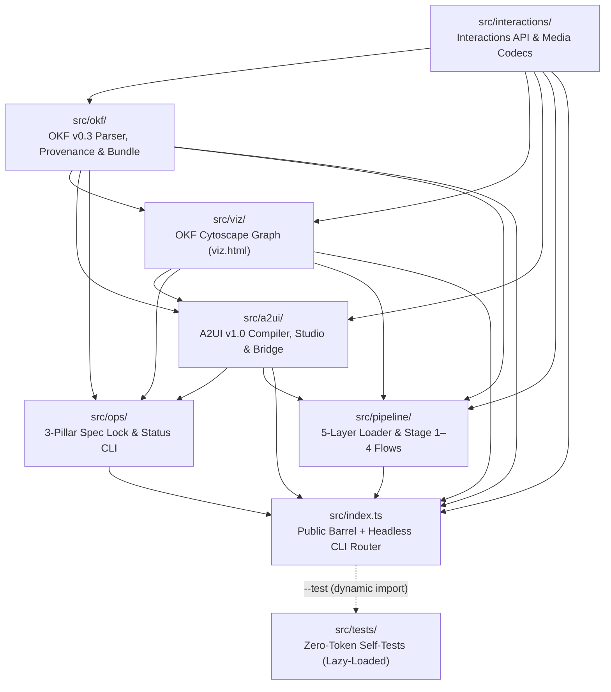

# ICM Engine Architecture & Routing Map (`src/CONTEXT.md`)

This directory contains the zero-dependency TypeScript/Node.js engine for **Open Knowledge Studio** (**ICM** + **OKF v0.3** + **A2UI v1.0**).

> **Downstream Customization Boundary:** Standard domain specialization (`workspace/GEMINI.md`, `workspace/CONTEXT.md`, `workspace/_config/voice_guide.md`, and `prompts/01_research.md` through `prompts/04_audio.md`) requires **zero edits inside `src/`**. Read a subsystem `CONTEXT.md` below only when extending the engine (e.g., wiring a custom structured-JSON stage runner) or maintaining core framework logic.

---

## Strict Topological Dependency DAG (`0` Cycles)

Every subsystem imports strictly downward—never introduce upward or circular imports between folders:

---

## Progressive Disclosure Routing Table

Read **only** the `CONTEXT.md` for the subsystem relevant to your task:

| Subsystem | Context Map | What Lives Inside |
| :--- | :--- | :--- |
| **Entrypoint & CLI** | [`src/index.ts`](./index.ts) | Public `export *` barrel (100% backwards-compatible API) + headless CLI flag dispatcher (`--stage1`..`--stage4`, `--verify`, `--viz`, `--a2ui`, `--ping-pong`, `--status`, `--spec-check`, `--test`). |
| **Interactions API & Media** | [`src/interactions/CONTEXT.md`](./interactions/CONTEXT.md) | `.env` loader, YAML stage contract parser, Handlebars renderer, Layer 3 `workspace/_config/locale.json` UI & TTS prosody schema/loader + IETF BCP-47 language detector (`locale.ts`), `gemini-4-argon` SSE client, `gemini-nano-banana-2.1` image client, `gemini-3.8-flash-tts` single/multi-speaker TTS client, magic-byte MIME sniffer, and RIFF/WAV parser/resampler (`media.ts`). |
| **OKF v0.3 & Bundle** | [`src/okf/CONTEXT.md`](./okf/CONTEXT.md) | OKF v0.3 YAML frontmatter parser/serializer, HTTP/HTML/PDF `last_modified` extractors, domain provenance audit, UTF-8 byte-offset grounding snapper (`cleanGroundingLinks`), zero-token source curation (`curateOkfSources`), and `workspace/bundle/` graph sync. |
| **OKF Graph Explorer** | [`src/viz/CONTEXT.md`](./viz/CONTEXT.md) | Bundle walker, universal ISO 639-1 language & domain-mode (`course`/`analysis`) detectors, standalone [`client/viz.css`](./viz/client/viz.css) + [`client/viz.js`](./viz/client/viz.js), and single-file `viz.html` compiler. |
| **A2UI v1.0 & Studio** | [`src/a2ui/CONTEXT.md`](./a2ui/CONTEXT.md) | A2UI v1.0 envelope/component types, Stage 2 data normalizer, RFC 6901 JSON Pointer engine, Tier 1/Tier 2 catalog validator, standalone [`client/studio.css`](./a2ui/client/studio.css) + [`client/studio.js`](./a2ui/client/studio.js), `generateA2uiSurface` (`mediaUrisByRun` deduplication + `locale.json` UI/TTS hydration), and AGY Ping-Pong wakeup listener. |
| **Spec Lock & Status** | [`src/ops/CONTEXT.md`](./ops/CONTEXT.md) | 3-pillar upstream GitHub lock checker (`ICM`, `OKF v0.3`, `A2UI v1.0`) and zero-token ASCII/JSON pipeline dashboard (`cli:status`). |
| **ICM Pipeline Flows** | [`src/pipeline/CONTEXT.md`](./pipeline/CONTEXT.md) | 5-layer context loader (`GEMINI.md`, `CONTEXT.md`, `_config/`, `bundle/`), `runStage1Flow`–`runStage4Flow` (with on-the-fly Layer 3 `ensureWorkspaceLocaleConfig`), `verifyOkfConcept`, locale-pack TTS prosody normalizer (`prepareTextForStudioTts`), and dialogue turn segmenter. |
| **Zero-Token Self-Tests** | [`src/tests/CONTEXT.md`](./tests/CONTEXT.md) | Programmatic `tsc --noEmit` gate + comprehensive zero-token, zero-network test assertions (`npm test`). |
| **Normative Standards & Registries** | [`specification/STANDARDS_AND_REFERENCES.md`](../specification/STANDARDS_AND_REFERENCES.md) | Canonical map of all ISO / IETF RFC / W3C / IANA / RIFF-WAV standards, standards-body prefixes, and government umbrella portals implemented across `src/` (keep synchronized with [`src/okf/provenance.ts`](./okf/provenance.ts) & [`src/a2ui/client/studio.js`](./a2ui/client/studio.js)). |
